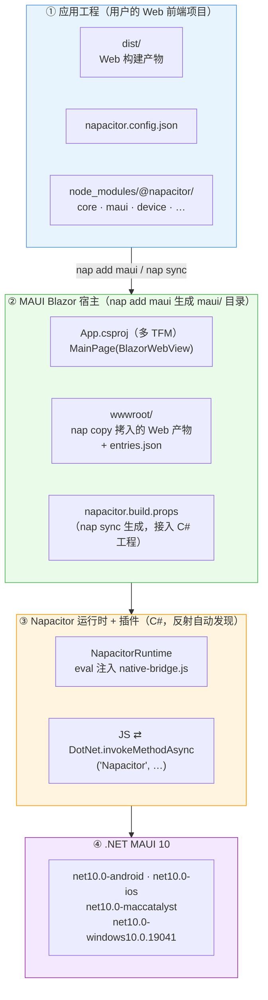
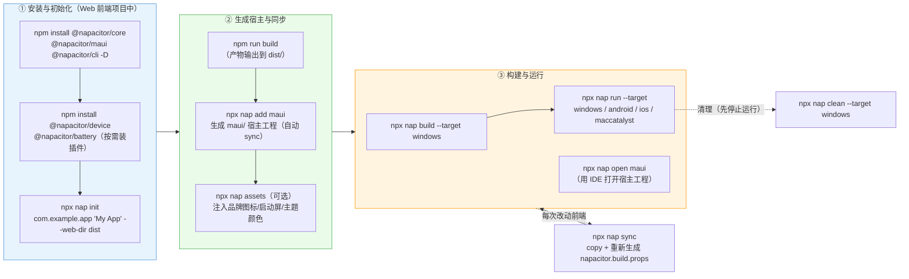
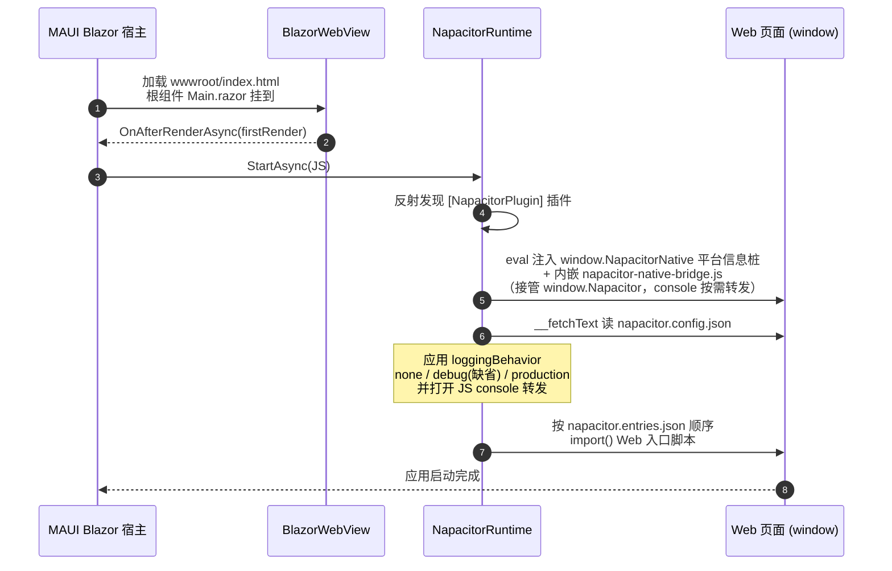
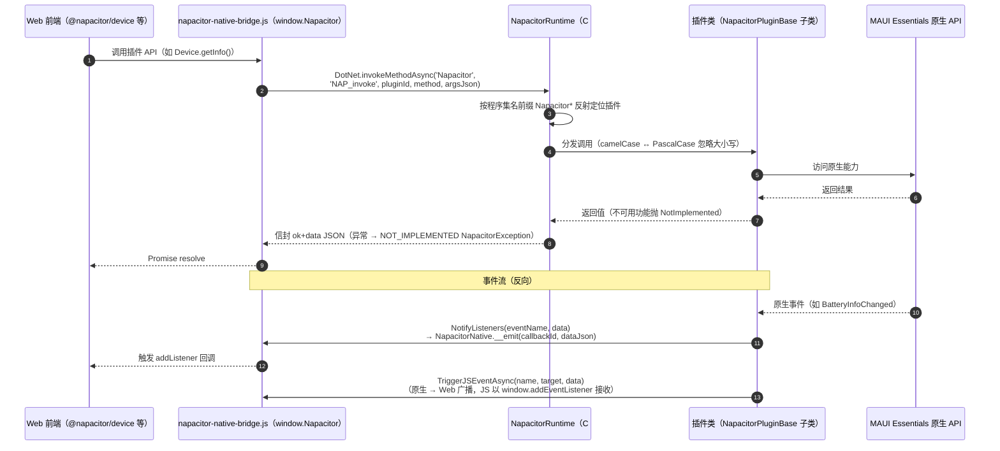
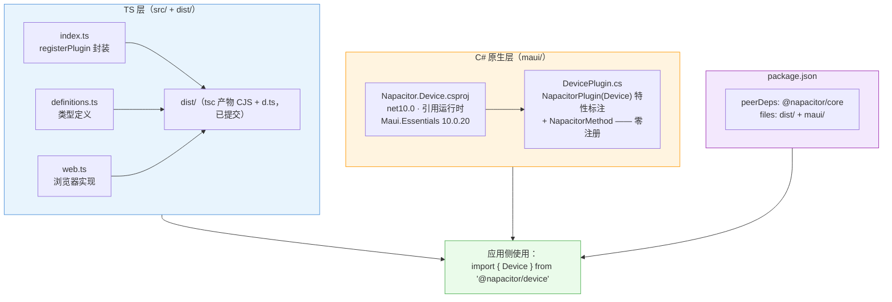
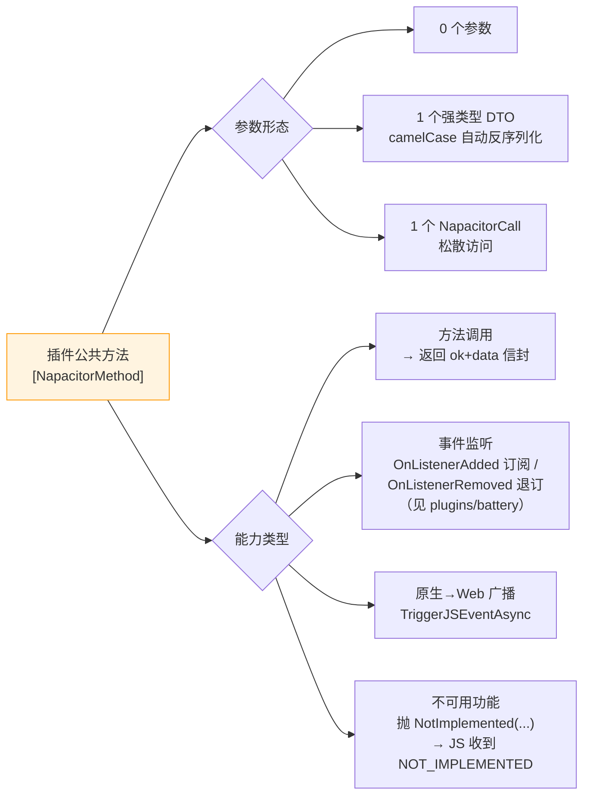
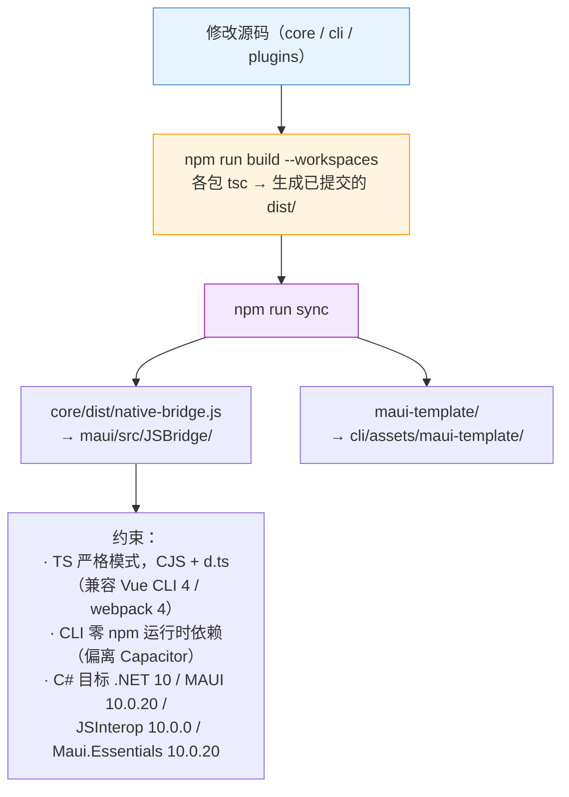

# Napacitor 流程图集

> 依据 [Napacitor.md](./Napacitor.md) 整理的专业流程框图，全部使用 Mermaid 绘制（支持 VS Code / GitHub / AtomGit 原生渲染）。

---

## 1. 总体架构分层图

自顶向下四层：应用工程 → MAUI Blazor 宿主 → Napacitor 运行时 + 插件 → .NET MAUI。

---

## 2. 用户工作流（快速上手，与 Capacitor 同形）

> 注：Windows 平台的 `run` 不含构建，需先 `build` 再 `run`；应用运行中会锁定 DLL，`clean` 前需先停止。

---

## 3. 宿主启动模型（时序）

---

## 4. 插件调用链路（JS ⇄ C# 双向通信）

---

## 5. 插件开发结构（三段式，以 plugins/device 为样板）

### C# 侧要点分支

---

## 6. 内置插件与原生映射总览

```mermaid
flowchart LR
    subgraph PLUGINS["官方插件套件（20 个）"]
        direction TB
        G1["设备信息类<br/>device · battery · app-info"]
        G2["交互类<br/>haptics · dialog · action-sheet · clipboard"]
        G3["分享与通信类<br/>share · email · sms · phone-dialer<br/>browser · app-launcher · file-viewer"]
        G4["系统状态类<br/>connectivity · flashlight · motion"]
        G5["数据类<br/>preferences · geolocation"]
    end

    subgraph ESSENTIALS["MAUI Essentials 映射"]
        E1["DeviceInfo · CultureInfo"]
        E2["Clipboard.SetTextAsync / GetTextAsync"]
        E3["Vibration（10/25/40ms 时长映射，Windows 无操作）"]
        E4["Share.RequestAsync(ShareTextRequest)"]
        E5["Battery.ChargeLevel / PowerSource /<br/>BatteryInfoChanged（事件管线示范）"]
    end

    PLUGINS --> RUN["NapacitorRuntime 反射发现<br/>（程序集名前缀 Napacitor*）"] --> ESSENTIALS

    style PLUGINS fill:#e8f4fd,stroke:#4a90d9
    style ESSENTIALS fill:#eafbea,stroke:#4caf50
    style RUN fill:#fff4e0,stroke:#ff9800
```

---

## 7. 仓库开发工作流

